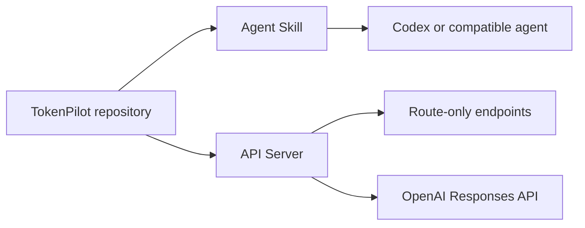

# TokenPilot GPT-5.6

> **Portable model-routing policy and optional API gateway for OpenAI GPT-5.6 Luna, Terra, and Sol.**

[](https://github.com/REPLACE_WITH_OWNER/tokenpilot-gpt-5-6/actions/workflows/ci.yml)
[](LICENSE)
[](docs/api.md)

TokenPilot provides an explainable routing policy for selecting among
**GPT-5.6 Luna**, **GPT-5.6 Terra**, and **GPT-5.6 Sol** according to
complexity, risk, confidence, context size, domain, and cost.

The repository distributes that policy in two independent components.

## Distribution

| Component | Path | Role | Runtime | Credentials |
|---|---|---|---|---|
| **Agent Skill** | [`skills/tokenpilot-router`](skills/tokenpilot-router) | Advisory routing policy for Codex and compatible agents | Host agent | None |
| **API Server** | [`app`](app) and [`config`](config) | Deterministic routing, cost controls, and optional OpenAI execution | Python 3.12 or Docker | OpenAI API key for execution |

Installing the Agent Skill does not install, start, or depend on the API
Server. Each component has its own installation path and operating boundary.



> [!NOTE]
> The Agent Skill is an advisory policy layer. It recommends a model tier but
> does not change the model running the current agent session. The API Server
> performs executable routing for applications that call OpenAI directly.

## Agent Skill

Use the Agent Skill when the routing policy should be available inside Codex
without operating a separate service.

- No OpenAI API key
- No Python environment
- No Docker runtime
- No server process

Install only the `skills/tokenpilot-router` directory. See the
[Codex installation guide](docs/install-skill.md) for personal and
repository-scoped installation.

Invoke the installed skill with:

```text
$tokenpilot-router
```

## API Server

Use the API Server when an application must select and call a model
programmatically. The server:

- defaults routine workloads to Luna;
- escalates nuanced workloads to Terra;
- reserves Sol for difficult or high-risk requests;
- enforces domain floors and per-request cost limits;
- exposes explainable decisions before provider spend;
- publishes Prometheus metrics and structured request logs.

An OpenAI API key is required only for `POST /v1/responses`. Route inspection,
catalog access, and cost estimation do not call OpenAI.

## Routing policy

| Tier | OpenAI model | Default use |
|---|---|---|
| Luna | `gpt-5.6-luna` | High-volume extraction, classification, summaries, and routine generation |
| Terra | `gpt-5.6-terra` | Technical work, ambiguity, low confidence, and larger context |
| Sol | `gpt-5.6-sol` | Critical, high-risk, or difficult reasoning workloads |

The versioned catalog includes OpenAI standard pricing published on
**2026-07-30**, including short- and long-context rates, cached input, cache
writes, and output. Regional processing, non-standard service tiers, and tool
fees are excluded. Review [`config/models.yaml`](config/models.yaml) against
the [official pricing page](https://developers.openai.com/api/docs/pricing)
before production use.

## Server quick start

```bash
git clone https://github.com/REPLACE_WITH_OWNER/tokenpilot-gpt-5-6.git
cd tokenpilot-gpt-5-6
python -m venv .venv
. .venv/bin/activate  # Windows: .venv\Scripts\Activate.ps1
python -m pip install -e ".[dev]"
cp .env.example .env
uvicorn app.main:app --reload --port 8080
```

Open [http://localhost:8080/docs](http://localhost:8080/docs) for the generated
OpenAPI documentation.

### Inspect a route

This endpoint does not call OpenAI:

```bash
curl -X POST http://localhost:8080/v1/route \
  -H "Content-Type: application/json" \
  -d '{
    "input": "Extract the order number and due date.",
    "signals": {"task_type": "extraction", "domain": "general"},
    "max_cost_usd": 0.01
  }'
```

### Execute a routed request

Configure `OPENAI_API_KEY`, then call:

```bash
curl -X POST http://localhost:8080/v1/responses \
  -H "Content-Type: application/json" \
  -d '{
    "input": "Summarize this support ticket in three bullets.",
    "signals": {"task_type": "summarization"}
  }'
```

## API surface

| Endpoint | Purpose |
|---|---|
| `POST /v1/route` | Return an explainable route without provider spend |
| `POST /v1/responses` | Route and execute an OpenAI Responses API request |
| `POST /v1/estimate` | Estimate cost from token counts |
| `GET /v1/models` | Return the versioned model and pricing catalog |
| `GET /health/live` | Liveness probe |
| `GET /health/ready` | Execution-aware readiness probe |
| `GET /metrics` | Prometheus metrics |

## Container deployment

```bash
cp .env.example .env
docker compose up --build
```

The image runs as a non-root user with a read-only runtime filesystem,
capability reduction, resource limits, and a health check.

## Documentation

- [Install the Agent Skill for Codex](docs/install-skill.md)
- [API reference](docs/api.md)
- [Architecture](docs/architecture.md)
- [Routing and fallback policies](docs/policies.md)
- [Cost model](docs/costs.md)
- [Evaluation strategy](docs/evaluation.md)
- [Deployment guide](docs/deployment.md)
- [Workflow integration](docs/n8n.md)

## Validation

```bash
ruff check .
ruff format --check .
pytest
python scripts/run_routing_evals.py
python scripts/validate_skill.py
python scripts/public_release_check.py
```

The test suite covers routing, cost enforcement, fallback behavior,
authentication, readiness, rate limiting, and observability.

## Project status

TokenPilot is independent open-source software and is not affiliated with,
endorsed by, or sponsored by OpenAI.

See [CONTRIBUTING.md](CONTRIBUTING.md), [SECURITY.md](SECURITY.md), and
[CODE_OF_CONDUCT.md](CODE_OF_CONDUCT.md). Licensed under
[Apache-2.0](LICENSE).
