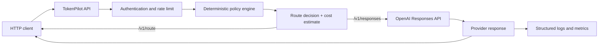

# Architecture

TokenPilot is a stateless FastAPI service. It deliberately separates **routing** from **execution** so callers can inspect a decision before spending on a provider request.

## Components

| Component | Responsibility |
|---|---|
| `app/routing.py` | Converts request signals into an explainable tier decision without using an extra model call |
| `config/policy.yaml` | Versioned thresholds, task weights, and domain safety floors |
| `config/models.yaml` | Versioned model IDs and cost inputs |
| `app/services/openai_executor.py` | Calls the Responses API and only escalates after retryable provider failures |
| `app/security.py` | API-key verification and a bounded in-memory sliding-window limiter |
| `app/observability.py` | Prometheus counters and latency histograms |

## Trust boundaries

1. **Client to TokenPilot:** authenticate with `X-TokenPilot-Key` in shared or production environments.
2. **TokenPilot to OpenAI:** keep `OPENAI_API_KEY` in the runtime secret store, never in requests, logs, images, or source files.
3. **Observability:** do not put prompt content, credentials, personal data, or full provider responses into metric labels. TokenPilot uses only bounded labels such as tier and domain.

## Design choices

- Routing is deterministic to avoid a second paid model call and to make policy review possible.
- Domain floors take precedence over caller model preferences. A legal request cannot be forced down to Luna, and safety requests default to Sol.
- A client may set a cost cap. The router only chooses Luna as a budget fallback when that still satisfies the policy floor; otherwise execution rejects the request.
- The per-request cap is checked again before each escalation. Monthly budgets require persistent external accounting.
- The service does not claim to assess factual correctness. The `confidence` signal is supplied by the client or an upstream quality system and is treated conservatively.
- The in-memory limiter is intentionally simple for a single replica. Use a shared rate limiter or API gateway before horizontally scaling.
